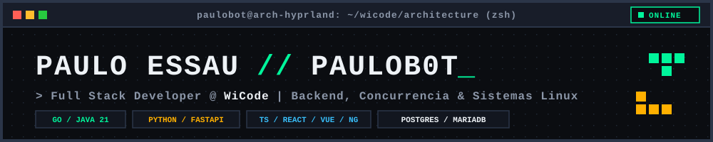

  

    

  

    &nbsp;
    &nbsp;
    &nbsp;
    
  

 

## Perfil Técnico

Soy **Paulo Essau**, desarrollador Full Stack en **WiCode** (México). Diseño y construyo backends transaccionales, sistemas multi-tenant, herramientas de control remoto en Linux (Arch / Hyprland) e interfaces web tipadas de extremo a extremo.

En mi trabajo diario priorizo la integridad de datos en PostgreSQL y MariaDB (bloqueos pesimistas, control optimista, aislamiento por tenant), binarios ligeros en Go y C++20, y arquitecturas limpias con contratos OpenAPI, Prisma o SQLAlchemy conectados a clientes en React, Vue, Angular y Flutter.

---

## Sistemas Principales (Spotlight)

<table>
  <tr>
    <td width="50%" valign="top">
      <h3>Paulobot: Go Telegram Daemon (AGY & Claude Code)</h3>
      

        Demonio de control remoto y gestor de sesiones escrito <strong>100% en Go puro</strong> (0 dependencias externas, 0 Python, consumo de <strong>1.5 MB a 10 MB de RAM</strong>). Compila en un binario único que integra el bot de Telegram, el monitor de cuotas para Waybar, el selector interactivo en Rofi y los hooks nativos del CLI.
      

      <ul>
        <li>Streaming JSON en tiempo real alternando al vuelo entre Antigravity CLI (<code>agy</code>) y Claude Code (<code>claude</code>).</li>
        <li>Terminación recursiva de árboles de procesos leyendo <code>/proc/&lt;pid&gt;/task/*/children</code> en menos de 50 ms.</li>
        <li>Pipeline directo de PDFs e imágenes desde Telegram hacia bóvedas de Obsidian y generador de prompts técnicos WiCode.</li>
      </ul>
      

        
        
        
        
      

      

        <a href="https://github.com/Paulob0t/bot_telegram_agy"><strong>[ Ver Repositorio en GitHub &raquo; ]</strong></a>
      

    </td>
    <td width="50%" valign="top">
      <h3>SeatLock: High-Concurrency Reservation Engine</h3>
      

        Motor de reservación de asientos diseñado para impedir sobreventas (<strong>zero overbooking</strong>) bajo peticiones concurrentes masivas. Serializa el apartado crítico en base de datos y sincroniza el estado visual de los asientos con los clientes conectados.
      

      <ul>
        <li>Concurrencia gestionada con <strong>Java 21 Virtual Threads (Project Loom)</strong> sobre Spring Boot 3.3.</li>
        <li>Doble barrera de integridad: bloqueo pesimista (<code>SELECT ... FOR UPDATE</code>), control optimista (<code>@Version</code>) e índice único parcial en PostgreSQL 16.</li>
        <li>Tarea programada (Janitor Task) con <code>JOIN FETCH</code> que libera reservas caducadas (TTL 10 min) cada 30 segundos.</li>
      </ul>
      

        
        
        
        
        
      

      

        <a href="https://github.com/Paulob0t/seatlock-back"><strong>[ Backend Repo &raquo; ]</strong></a>
        &nbsp;&bull;&nbsp;
        <a href="https://github.com/Paulob0t/seatlock-front"><strong>[ Frontend Repo &raquo; ]</strong></a>
      

    </td>
  </tr>
</table>

---

## Plataformas Full Stack & Multi-Tenant

<table>
  <tr>
    <td width="50%" valign="top">
      <h3>PuvloBuilder: Multi-Tenant CMS & Page Builder</h3>
      

        CMS modular multi-tenant con editor visual en lienzo (tiradores de redimensionamiento en vivo, ajuste magnético sin brechas y sincronización exacta entre editor y vista pública). Incluye módulo CRUD de clientes, autenticación JWT de dos niveles (SuperAdmin y Sub-Admin por proyecto) y aislamiento físico de archivos.
      

      

        
        
        
        
        
      

      

        <a href="https://github.com/Paulob0t/PuvloBuilder_Back"><strong>[ Backend Repo &raquo; ]</strong></a>
        &nbsp;&bull;&nbsp;
        <a href="https://github.com/Paulob0t/PuvloBuilder_Front"><strong>[ Frontend Repo &raquo; ]</strong></a>
      

    </td>
    <td width="50%" valign="top">
      <h3>Puvnex CRM: Cloud Hosting & Billing Suite</h3>
      

        Sistema de gestión de clientes, aprovisionamiento de dominios y hosting, facturación, tickets de soporte técnico y portal de autoservicio. API REST asíncrona protegida con control de acceso por roles (RBAC) y panel administrativo en Vue 3.5.
      

      

        
        
        
        
        
      

      

        <a href="https://github.com/Paulob0t/Puvnex_backend"><strong>[ Backend Repo &raquo; ]</strong></a>
        &nbsp;&bull;&nbsp;
        <a href="https://github.com/Paulob0t/Puvnex_frontend"><strong>[ Frontend Repo &raquo; ]</strong></a>
      

    </td>
  </tr>
  <tr>
    <td width="50%" valign="top">
      <h3>FreelancerHub: Escrow & Algorithmic Governance</h3>
      

        Plataforma de intermediación para proyectos freelance con custodia de fondos (Escrow) y módulos de decisión algorítmica (MDP). Construida bajo Clean/Onion Architecture con backend en Node.js 22 LTS, cliente web en React y aplicación móvil en Flutter.
      

      

        
        
        
        
      

      

        <a href="https://github.com/IDGS1004-23001526/freelancer_hub_backend"><strong>[ Backend &raquo; ]</strong></a>
        &nbsp;&bull;&nbsp;
        <a href="https://github.com/IDGS1004-23001526/freelancer_hub_frontend"><strong>[ Web &raquo; ]</strong></a>
        &nbsp;&bull;&nbsp;
        <a href="https://github.com/IDGS1004-23001526/freelancer_hub_frontend_movil"><strong>[ Móvil &raquo; ]</strong></a>
      

    </td>
    <td width="50%" valign="top">
      <h3>PauloBot Store v2: Vending Machines & POS</h3>
      

        Comercio automatizado y punto de venta 24/7 para máquinas expendedoras. Backend en FastAPI con conversión automática de imágenes a WebP, contratos OpenAPI 3.0 con generación de cliente HTTP tipado (<code>ng-openapi-gen</code>) para Angular 22 y base de datos en Podman.
      

      

        
        
        
        
        
      

      

        <a href="https://github.com/Paulob0t/PauloBotStore_Back"><strong>[ Backend Repo &raquo; ]</strong></a>
        &nbsp;&bull;&nbsp;
        <a href="https://github.com/Paulob0t/PauloBotStore_Front"><strong>[ Frontend Repo &raquo; ]</strong></a>
      

    </td>
  </tr>
</table>

---

## Motores Nativos, Desktop & Otros Proyectos

| Proyecto | Stack | Implementación Técnica | Repositorio |
| :--- | :--- | :--- | :--- |
| **Tetris-Qt6 & Sand Physics** | `C++20` `Qt 6` `CMake` | Juego nativo a 60 FPS con modo clásico (7-Bag, Lock Delay, Hold) y **Sand Tetris** basado en autómatas celulares y sistema de partículas. | [Paulob0t/Tetris-Qt6](https://github.com/Paulob0t/Tetris-Qt6) |
| **Portafolio Pixel-Architect** | `TypeScript 5.9` `Vite 6` `Canvas 2D` | Portafolio interactivo con estética Tiling WM, simulador de autómatas celulares Sand-Tetris en vivo y terminal zsh emulada. | [Paulob0t/Portafoli_PauloEssau](https://github.com/Paulob0t/Portafoli_PauloEssau) |
| **Laboratorio 3D en Godot 4** | `GDScript` `Godot 4` | Importación de mallas `.obj`, controlador `CharacterBody3D` y geometría de colisiones a medida. | [Paulob0t/Aprendiendo-a-crear-un-videojuego](https://github.com/Paulob0t/Aprendiendo-a-crear-un-videojuego) |
| **Recordatorios & Presupuesto** | `Kotlin` `Android SDK` | Aplicación nativa Android para control de presupuesto personal y seguimiento de cuentas pendientes. | [Paulob0t/Recordatorios_app](https://github.com/Paulob0t/Recordatorios_app) |

---

## Arsenal Técnico

| Dominio | Tecnologías en Uso |
| :--- | :--- |
| **Lenguajes** |  |
| **Backend & Frameworks** |  |
| **Frontend, Mobile & UI** |  |
| **Datos, Linux & DevOps** |  |

---

## Actividad y Métricas en GitHub

  
    
  
  

